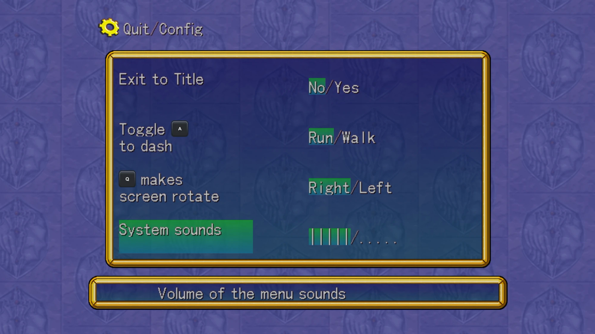

# GranasSabre

Adds a volume bar for the menu sounds (cursor, confirm, cancel) to the in-game
config menu of **Grandia II HD Remaster / Anniversary Edition** (PC).

- Menu → Quit/Config → **System sounds**: Left/Right changes the volume, from mute to original
- Saved with your save file, default is −12 dB
- Music, voices and other sounds are not affected
- English, German, French and Japanese

## Install

1. [Download](../../releases) `GranasSabre-<version>.zip`.
2. Copy the `GranasSabre` folder into your game folder, next to `grandia2.exe`
   (Steam: right-click the game → Manage → Browse local files).
3. Run `GranasSabre.exe` and press **P**.

**Uninstall:** run `GranasSabre.exe` and press **R**, or let Steam verify the game files.

## Notes

- Supports the current Steam version (2022-04-02) and the 2020 build. Other
  versions are refused without changes. If yours is refused, please
  [open an issue](../../issues).
- Steam updates and "Verify integrity of game files" remove the patch. Run the tool again afterwards.
- Your original files are backed up first. No game files are included.
- Some antivirus scanners flag tools packed with PyInstaller. The source is included
  (`GranasSabre.py`), and you can run it with Python 3.8+ instead of the exe.

## Deutsch

Fügt dem Konfigurationsmenü im Spiel einen Lautstärke-Balken für die Menü-Sounds
hinzu. Installation: ZIP herunterladen, den Ordner `GranasSabre` in den Spielordner
kopieren, `GranasSabre.exe` starten und **P** drücken. **R** stellt alles wieder her.

---

MIT License · Unofficial fan project, not affiliated with the game's publishers ·
Technical details: [dev/BUILD.md](dev/BUILD.md)
